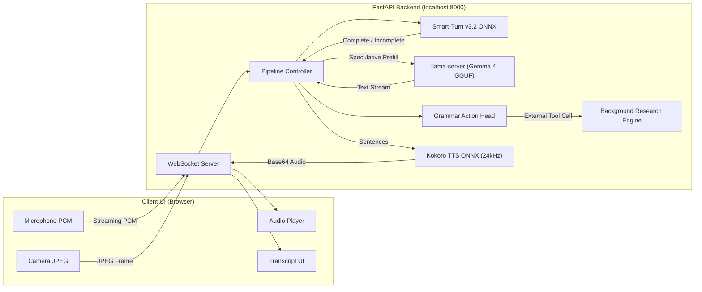

# Parlor — File Structure & Feature Scope Specification

> **Project:** Parlor — Fully On-Device, Real-Time Multimodal AI Voice & Vision Assistant  
> **Document Purpose:** Complete reference specification of project file organization, component responsibilities, real-time feature capabilities, architectural data flows, and operational scope.

---

## 1. Executive Summary

**Parlor** is a privacy-first, on-device multimodal AI assistant capable of real-time conversational voice interaction, visual understanding via camera stream, hands-free turn-taking, neural text-to-speech synthesis, and local/remote tool execution.

Designed as an ultra-low-latency cascade architecture, Parlor couples browser-based client controls with a Python FastAPI backend. It achieves sub-second **Time to First Audio (TTFA ~0.7s - 0.8s)** by speculatively priming llama.cpp prompt caches with camera frames and streaming audio chunks as the user speaks.

---

## 2. Directory & File Structure

```
parlor-main/
│
├── .env                              # Environment variable overrides (API keys, ports, model paths)
├── .env.example                      # Template for environment configuration
├── .gitignore                        # Git exclusions (.venv, cached models, temporary files)
├── CHANGELOG.md                      # Historical log of version updates and release notes
├── FEATURE_SCOPE_AND_FILE_STRUCTURE.md # Complete project feature scope & directory specification
├── LICENSE                           # Software license (MIT)
├── PROJECT_STATUS_AND_ARCHITECTURE.md# System status, benchmark results & architecture overview
├── README.md                         # Primary documentation, setup guide & quick start
├── pyproject.toml                    # Python project configuration, dependencies, and entrypoints
├── start.ps1                         # PowerShell launcher script for Windows environment
├── stop.ps1                          # PowerShell script to stop server and clean up processes
├── step3_audio_features.py           # Standalone audio feature extraction & mel-spectrogram helper
├── uv.lock                           # Lockfile maintaining strict package dependency trees
│
├── docs/                             # Documentation suite
│   └── configuration.md              # Detailed reference for configuration flags & env variables
│
├── src/                              # Core application source code
│   └── parlor/                       # Main Python package
│       ├── __init__.py               # Package initialization marker
│       ├── actions.py                # Action grammar rules, tool definitions (timers, search, modes)
│       ├── llama.py                  # Process controller & HTTP client for llama-server
│       ├── modes.py                  # System operating modes (Conversation, Translation, Listen)
│       ├── pipeline.py               # Main pipeline orchestrator connecting turns, LLM, TTS, & actions
│       ├── reasoner.py               # Asynchronous background reasoning & web research engine
│       ├── server.py                 # FastAPI server, WebSocket endpoints, static asset routing
│       ├── tts.py                    # Neural text-to-speech synthesis engine (Kokoro-ONNX)
│       ├── turn_detector.py          # Acoustic end-of-turn classifier (smart-turn-v3.2 ONNX)
│       └── web/                      # Frontend single-page application
│           ├── index.html            # Main HTML layout, visualizer containers, and controls
│           └── static/
│               ├── app.js            # Web Audio API recorder, WebSocket client, dynamic UI updates
│               └── style.css         # Dark theme styling, dynamic canvas overlays, responsive layout
│
├── tests/                            # Comprehensive Pytest test suite
│   ├── conftest.py                   # Test fixtures, mock environments, and server hooks
│   ├── test_conversation.py          # End-to-end conversation flow verification
│   ├── test_delegation.py            # Delegation mode and background research testing
│   ├── test_elapsed.py               # Timing precision and time-awareness tests
│   ├── test_history.py              # Multi-turn conversation state & history retention tests
│   ├── test_listen.py                # Passive listening (scribe) mode testing
│   ├── test_llama_startup.py         # Subprocess lifecycle and readiness checks for llama-server
│   ├── test_robustness.py           # Network dropouts, malformed data, and fault tolerance tests
│   ├── test_stream_parser.py         # Streaming token parser and action tag extraction tests
│   ├── test_timer.py                 # Countdown timer creation, ring, and cancellation tests
│   ├── test_transcription_stability.py# Audio stream integrity & transcription alignment tests
│   ├── test_translation.py          # Consecutive live translation mode testing
│   ├── test_z_failure.py            # Edge case failure modes and graceful error recovery
│   └── util.py                       # Helper functions and mock streaming data generators for tests
│
└── benchmarks/                       # Performance evaluation and latency measurement suite
    ├── archbench.py                  # End-to-end architecture latency & token throughput benchmark
    ├── bench.py                      # Master benchmark runner for regression testing
    ├── benchmark_tts.py              # TTS audio synthesis latency and RTF (Real-Time Factor) probe
    ├── camerabench.py                # Camera frame prefilling overhead & cache priming benchmark
    ├── compare.py                    # Benchmark comparison script across multiple runs
    ├── fixtures.py                   # Benchmark dataset fixtures and audio input samples
    ├── legacy_tags.py                # Comparative benchmark for in-band vs grammar-forced actions
    ├── tagbench.py                   # Action tag classification latency & accuracy benchmark
    ├── timerprobe.py                 # Timer precision & background execution probe
    ├── turnbench.py                  # Smart-Turn classifier latency & decision boundary evaluation
    ├── fixtures/                     # Test audio clips and benchmark data files
    └── results/                      # Generated benchmark outputs and latency metrics JSON files
```

---

## 3. Comprehensive File Catalog & Module Breakdown

### 3.1 Core Package (`src/parlor/`)

| File / Component | Primary Responsibility | Key Functions & Dependencies |
| :--- | :--- | :--- |
| [`server.py`](file:///c:/Users/ramav/Downloads/parlor-main/parlor-main/src/parlor/server.py) | **FastAPI Server & WebSocket Gateway**: Manages HTTP routes, serves static assets, hosts WebSocket endpoint (`/ws`), handles bi-directional audio/video streams, and controls session lifecycle. | FastAPI, Uvicorn, WebSockets, UTF-8 console stream handler, dynamic port handling. |
| [`pipeline.py`](file:///c:/Users/ramav/Downloads/parlor-main/parlor-main/src/parlor/pipeline.py) | **Central Orchestrator**: Coordinates turn detection, prompt cache priming, LLM request streaming, sentence parsing, action execution, and TTS generation. | Asyncio pipelines, cache management, state transitions. |
| [`turn_detector.py`](file:///c:/Users/ramav/Downloads/parlor-main/parlor-main/src/parlor/turn_detector.py) | **Smart Turn Classifier**: Evaluates whether user finished their thought using `smart-turn-v3.2` ONNX model (~70ms execution). | ONNX Runtime, NumPy, audio windowing & mel-spectrogram extraction. |
| [`llama.py`](file:///c:/Users/ramav/Downloads/parlor-main/parlor-main/src/parlor/llama.py) | **LLM Subprocess Wrapper**: Spawns and manages `llama-server` hosting Gemma 4 GGUF models. Handles HTTP completions, prefix caching, and health checks. | Subprocess management, requests/httpx, JSON response parsing. |
| [`tts.py`](file:///c:/Users/ramav/Downloads/parlor-main/parlor-main/src/parlor/tts.py) | **Speech Synthesizer**: Converts text sentences into 24 kHz raw PCM audio using `kokoro-onnx` neural model running on local CPU/GPU. | Kokoro ONNX, SoundFile, base64 audio chunk encoding. |
| [`actions.py`](file:///c:/Users/ramav/Downloads/parlor-main/parlor-main/src/parlor/actions.py) | **Grammar-Forced Action Engine**: Parses and executes structured JSON tool calls (timers, web search, mode switches) out-of-band to prevent speech corruption. | Regex, Pydantic, GBNF/JSON grammar specifications. |
| [`reasoner.py`](file:///c:/Users/ramav/Downloads/parlor-main/parlor-main/src/parlor/reasoner.py) | **Background Web Research**: Offloads complex research tasks to external frontier models (e.g. via OpenRouter/OpenAI API) asynchronously while conversation continues. | Async HTTP client, web search integration. |
| [`modes.py`](file:///c:/Users/ramav/Downloads/parlor-main/parlor-main/src/parlor/modes.py) | **Operating Mode Handler**: Manages system state shifts between Conversation, Live Translation, Passive Listening, and Delegation modes. | Enum definitions, state transition logic. |

### 3.2 Frontend Application (`src/parlor/web/`)

| File / Component | Primary Responsibility |
| :--- | :--- |
| [`index.html`](file:///c:/Users/ramav/Downloads/parlor-main/parlor-main/src/parlor/web/index.html) | Single-page UI container housing live transcript feed, camera canvas preview, microphone status controls, audio visualizer, and active timer chips. |
| [`app.js`](file:///c:/Users/ramav/Downloads/parlor-main/parlor-main/src/parlor/web/static/app.js) | JavaScript client handling Web Audio API mic recording (16 kHz PCM), WebSocket communication, incoming base64 audio queue playback, camera frame capture (JPEG encoding), and UI state rendering. |
| [`style.css`](file:///c:/Users/ramav/Downloads/parlor-main/parlor-main/src/parlor/web/static/style.css) | Custom modern dark theme styling with visualizer animations, response status indicators, timer widgets, and responsive layout grids. |

### 3.3 Test Suite (`tests/`)

| Test Module | Coverage Scope |
| :--- | :--- |
| [`test_conversation.py`](file:///c:/Users/ramav/Downloads/parlor-main/parlor-main/tests/test_conversation.py) | Verifies full turn execution: voice input -> turn classifier -> LLM generation -> TTS playback. |
| [`test_delegation.py`](file:///c:/Users/ramav/Downloads/parlor-main/parlor-main/tests/test_delegation.py) | Tests background reasoning delegation without blocking main conversation audio stream. |
| [`test_elapsed.py`](file:///c:/Users/ramav/Downloads/parlor-main/parlor-main/tests/test_elapsed.py) | Validates time-awareness logic (silence duration, session runtime, elapsed time tracking). |
| [`test_history.py`](file:///c:/Users/ramav/Downloads/parlor-main/parlor-main/tests/test_history.py) | Ensures context history pruning, message buffering, and cache stability across turns. |
| [`test_listen.py`](file:///c:/Users/ramav/Downloads/parlor-main/parlor-main/tests/test_listen.py) | Verifies Passive Listening (scribe) mode where audio is transcribed visually without TTS output. |
| [`test_llama_startup.py`](file:///c:/Users/ramav/Downloads/parlor-main/parlor-main/tests/test_llama_startup.py) | Validates process launching, model path detection, port binding, and health checks for `llama-server`. |
| [`test_robustness.py`](file:///c:/Users/ramav/Downloads/parlor-main/parlor-main/tests/test_robustness.py) | Tests resilience against bad audio formats, rapid barge-in cancellations, and network disconnects. |
| [`test_stream_parser.py`](file:///c:/Users/ramav/Downloads/parlor-main/parlor-main/tests/test_stream_parser.py) | Tests token stream parser for sentence boundary splitting and action tag identification. |
| [`test_timer.py`](file:///c:/Users/ramav/Downloads/parlor-main/parlor-main/tests/test_timer.py) | Tests server-side countdown timers, active state tracking, ring announcements, and UI cancel events. |
| [`test_translation.py`](file:///c:/Users/ramav/Downloads/parlor-main/parlor-main/tests/test_translation.py) | Validates consecutive live translation mode behavior for multi-lingual inputs. |

### 3.4 Benchmarking Suite (`benchmarks/`)

| Benchmark File | Metric / Objective |
| :--- | :--- |
| [`archbench.py`](file:///c:/Users/ramav/Downloads/parlor-main/parlor-main/benchmarks/archbench.py) | Measures full pipeline TTFA, token generation rates, and streaming latencies under real-world multi-modal loads. |
| [`turnbench.py`](file:///c:/Users/ramav/Downloads/parlor-main/parlor-main/benchmarks/turnbench.py) | Benchmarks accuracy and latency (~70ms) of `smart-turn-v3.2` classifier on completed vs incomplete sentences. |
| [`benchmark_tts.py`](file:///c:/Users/ramav/Downloads/parlor-main/parlor-main/benchmarks/benchmark_tts.py) | Evaluates Kokoro-ONNX audio generation throughput (Real-Time Factor / RTF) across sentence lengths. |
| [`camerabench.py`](file:///c:/Users/ramav/Downloads/parlor-main/parlor-main/benchmarks/camerabench.py) | Measures vision frame prefilling time and impact on LLM prompt cache performance. |
| [`tagbench.py`](file:///c:/Users/ramav/Downloads/parlor-main/parlor-main/benchmarks/tagbench.py) | Evaluates grammar-forced tool call parsing accuracy vs in-band token generation. |
| [`timerprobe.py`](file:///c:/Users/ramav/Downloads/parlor-main/parlor-main/benchmarks/timerprobe.py) | Tests precision of background timers during active and idle speech turns. |

---

## 4. Feature Scope & Functional Capabilities



### 4.1 Real-Time Audio & Vision Ingestion
- **Continuous Mic Streaming**: Client captures raw PCM audio at 16 kHz via Web Audio API and streams binary chunks over WebSocket.
- **Client VAD & Silence Detection**: Integrated browser-side Silero VAD detects speech pauses (~200ms threshold) without needing manual push-to-talk.
- **Multimodal Vision Priming**: Camera frames captured periodically or on demand (JPEG format) are prefilled directly into `llama-server` prompt cache alongside audio tokens while the user is still speaking.

### 4.2 Acoustic Turn-Taking Intelligence
- **On-Device Smart-Turn Classifier**: Runs `smart-turn-v3.2` ONNX model (~70ms latency) to evaluate speaker intent completion.
- **Mid-Thought Pause Handling**: If the user pauses mid-sentence (e.g. "I want to ask... um..."), the system holds execution silently until the thought is finished or silence timeout expires.

### 4.3 Low-Latency LLM Streaming & Cache Priming
- **llama-server Subprocess Management**: Runs local quantized GGUF models (**Gemma 4 E2B**, **E4B**, or **12B**).
- **Prefix Caching & Speculative Execution**: Speech and vision tokens are prefilled in real time during the user's turn, delivering sub-second **Time to First Audio (TTFA ~0.7s - 0.8s)**.
- **Transcript-First Commitment**: Reply starts by streaming the perceived user utterance transcript immediately on screen to boost context alignment and user confidence.

### 4.4 Out-of-Band Grammar Action Execution
- **Speech-Pure TTS Generation**: Tools and actions (timers, mode switches, research) are evaluated using a grammar-forced JSON head operating over the shared prompt cache.
- **Zero Control Tag Leakage**: Actions execute out-of-band, preventing markup tokens from corrupting speech output or breaking neural TTS synthesis.
- **Server-Side Timers**: Server maintains absolute clock authority for countdown timers ("Set a timer for 3 minutes"), displaying countdown chips in UI and announcing completion out loud.

### 4.5 Operating Modes
1. **Conversation Mode**: Default bi-directional real-time multimodal conversational mode with full voice, vision, and tool support.
2. **Consecutive Live Translation Mode**: Acts as an interpreter ("Translate everything I say into English"), providing consecutive translations without conversational replies until explicitly stopped.
3. **Passive Listening (Scribe) Mode**: Transcribes spoken input continuously on screen without generating spoken responses ("Just listen for a while").
4. **Delegation / Background Research Mode**: Hands long-running web searches ("Find best pizza in Rome") to a background frontier model (`reasoner.py`) while keeping voice interaction live.

### 4.6 Interruption & Barge-In Support
- **Server-Side Generation Cancellation**: Speaking over the AI instantly triggers a barge-in signal to abort LLM generation and stop audio chunk streaming.
- **Audio Queue Flush**: Client immediately clears Web Audio API playback queue upon detecting user speech start.

---

## 5. Environment & Configuration Scope

| Parameter | Environment Variable | Default Value | Description |
| :--- | :--- | :--- | :--- |
| **Gemma Model Size** | `MODEL` | `e4b` | Choice of model: `e2b` (fastest), `e4b` (recommended balance), `12b` (highest quality). |
| **Server Port** | `PORT` | `8000` | HTTP and WebSocket port binding. |
| **Reasoner API Key** | `REASONER_API_KEY` | `""` (Unset) | API key for remote research model (OpenRouter/OpenAI). Off by default for 100% local operation. |
| **Reasoner Endpoint** | `REASONER_BASE_URL` | `https://openrouter.ai/api/v1` | Base URL for background research LLM endpoint. |
| **Reasoner Model** | `REASONER_MODEL` | `openai/gpt-5.6-luna` | Model identifier used for background research queries. |
| **Hugging Face Token** | `HF_TOKEN` | `""` (Optional) | HF token for automatic model downloading. |

---

## 6. Future Expansion Roadmap

- [ ] **Full-Duplex Audio Model Integration**: Upgrade to native audio-in/audio-out neural models when local full-duplex open-weights become available.
- [ ] **GPU Acceleration for Kokoro TTS**: Add CUDA/DirectML runtime providers for ultra-fast multi-channel TTS synthesis.
- [ ] **Local Visual Memory & RAG**: Implement local vector database indexing for camera frame snapshots and document memory across long sessions.
- [ ] **Expanded Action Grammar**: Support local system controls (media playback, smart home control, desktop workflow automation).

---

*Documentation generated for Parlor codebase repository.*
