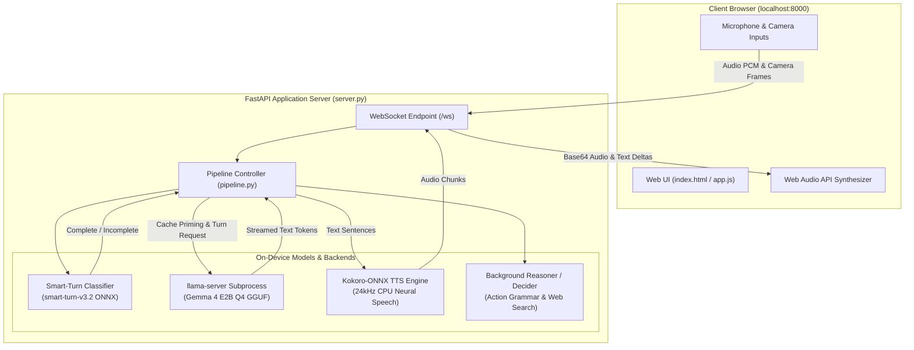

# Parlor — Setup Status & System Architecture Overview

This document summarizes the environment setup, fixes applied, verification results, and overall system architecture for **Parlor** (an on-device, real-time multimodal AI voice + vision assistant).

---

## 1. Completed Setup & Fixes Summary

| Task / Component | Status | Details |
| :--- | :---: | :--- |
| **Python Environment Setup** | ✅ Completed | Installed **Python 3.12.10** and recreated `.venv` from scratch. |
| **Dependency Management** | ✅ Completed | Batch installed all required dependencies (`fastapi`, `numpy` 2.5.1, `kokoro-onnx`, `onnxruntime`, `huggingface-hub`, `uvicorn`, `soundfile`). |
| **Hugging Face Authentication** | ✅ Configured | Added `HF_TOKEN` to `.env` and set persistent user environment variable (`setx`). Suppressed unauthenticated HF Hub warnings. |
| **Git Security** | ✅ Verified | Verified `.env` is listed in `.gitignore` to prevent credential leaks. |
| **Windows Console Encoding Fix** | ✅ Resolved | Fixed `UnicodeEncodeError` (`'charmap' codec can't encode '\u2192'`) in `src/parlor/server.py` by forcing UTF-8 stdout/stderr streams. |
| **Port Binding Management** | ✅ Resolved | Identified and terminated stale process occupying port `8000` (`netstat -ano` / `taskkill`), enabling clean server startups. |
| **System Verification & E2E Testing** | ✅ Passed | Tested web UI, OpenAPI docs (`/docs`), WebSocket connection (`/ws`), Turn Detector, LLM inference, and TTS audio streaming. |

---

## 2. Benchmark & Latency Verification Metrics

The real-time multimodal pipeline was verified with end-to-end WebSocket tests:

- **First Event Latency:** `0.26s`
- **Smart-Turn Classifier Decision Speed:** `0.07s` (70 ms)
- **LLM Prefill Time:** `0.203s`
- **LLM Generation Speed:** `0.337s`
- **Time to First Audio (TTFA):** `0.801s`
- **Total Turn Completion Time:** `1.26s`
- **TTS Sample Rate:** `24,000 Hz` (via `kokoro-onnx`)

---

## 3. System Architecture Overview

### Architecture Diagram



---

## 4. Component Breakdown & How It Works

### **1. Web Frontend & Server (`server.py`)**
- Built with **FastAPI** & **Uvicorn**, serving static assets (`/static`) and the single-page web UI (`index.html`).
- Establishes a persistent **WebSocket connection (`/ws`)** to stream bi-directional audio, camera frames, and model events.

### **2. Turn Detector (`turn_detector.py`)**
- Uses **smart-turn-v3.2** (ONNX audio classifier).
- Evaluates user audio completeness on-the-fly (**~40-80 ms latency**). If incomplete, segments are held in cache; if complete, execution proceeds to the LLM immediately.

### **3. LLM Inference Engine (`llama.py` & `pipeline.py`)**
- Spawns a background `llama-server` process hosting **Google Gemma 4 E2B QAT Q4 GGUF**.
- Employs **prefix caching** and **speculative cache priming**: camera frames and audio chunks are pre-filled while the user is still speaking, yielding **sub-second TTFA**.

### **4. Speech Synthesis / TTS (`tts.py`)**
- Powered by **`kokoro-onnx`** running locally on CPU.
- Converts text sentences to high-quality **24 kHz PCM audio chunks** streamed via WebSocket as base64 encodings.

### **5. Action Decider & Reasoner (`actions.py` & `reasoner.py`)**
- Grammar-forced classification for external operations: countdown timers, live translation mode, quiet listening mode, or background web research delegation.

---

## 5. How to Run the Application

To start the server cleanly:

```powershell
.venv\Scripts\python -m parlor.server
```

Then open your browser at:
👉 **`http://localhost:8000`**
