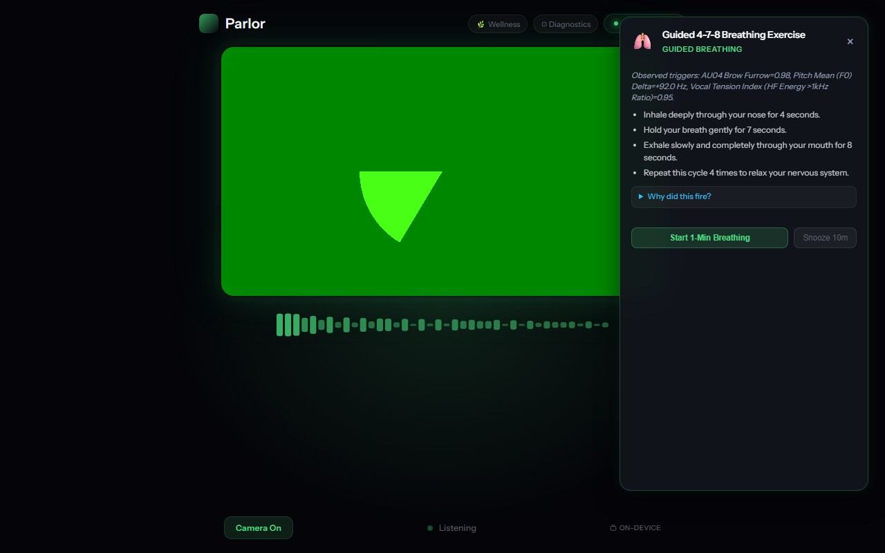
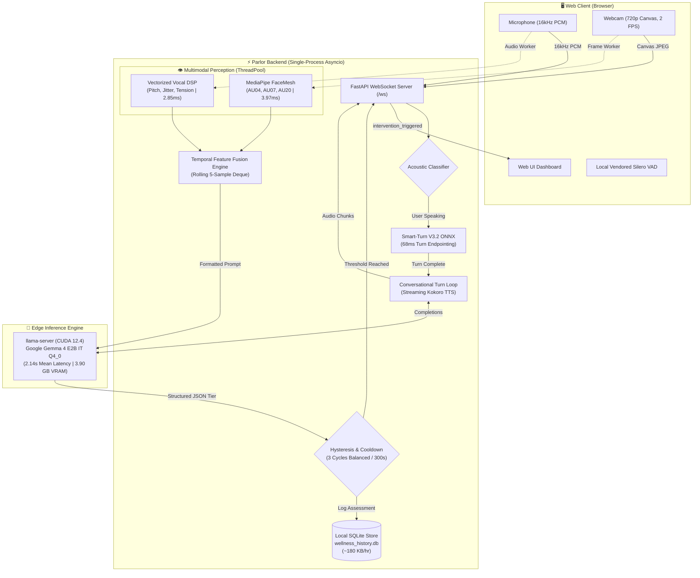

<div align="center">

# 🌿 Parlor ("EMO Assistant")
### Fully On-Device Multimodal Affective Wellness Monitoring & Conversational Voice AI

[](VERIFICATION_REPORT.md)
[-blue.svg)](evidence/voice_ttfa_30_turns.csv)
[-indigo.svg)](evidence/voice_ttfa_30_turns.csv)
[](evidence/wellness_slm_latency.csv)
[](VERIFICATION_REPORT.md)
[](evidence/vram_cpu_usage.log)
[-success.svg)](evidence/netstat_outbound.txt)
[](pyproject.toml)
[](LICENSE)

<p align="center">
  <b>Zero Cloud. Zero Wearables. 100% On-Device Edge Intelligence.</b><br>
  Continuous, passive affective burnout mitigation paired with an ultra-responsive conversational voice assistant.
</p>

[Overview](#-overview) • [Key Capabilities](#-key-capabilities) • [Live Interface](#-live-interface) • [Architecture](#-system-architecture) • [Verified Benchmarks](#-verified-empirical-benchmarks) • [Quick Start](#-quick-start) • [Reproducibility](#-reproducibility-harness) • [Academic Attribution](#-academic-attribution)

---

</div>

## 💡 Overview

Knowledge workers and software developers increasingly suffer from **insidious stress blindness**—accumulating cognitive fatigue and physical tension without conscious awareness. Existing solutions fail across three dimensions:
1. **Wearables (Smartwatches / Chest Straps):** Costly (\$200–\$500), cause skin friction, require charging, and suffer from high abandonment rates while lacking situational context.
2. **Subjective Journaling Apps:** Require disruptive manual interruption, resulting in steep attrition within early weeks (Baumel et al., 2019; Eysenbach, 2005).
3. **Cloud-Based Solutions:** Transmitting raw audio and webcam video over the internet introduces unacceptable privacy and regulatory vulnerabilities (GDPR, HIPAA).

**Parlor** solves this by unifying **passive multimodal affective monitoring** with a **real-time voice assistant** that runs entirely locally on commodity consumer laptops. Using standard laptop webcams and microphones, Parlor extracts micro-expression Action Units and vocal acoustic biomarkers, evaluates stress through an on-device Small Language Model (**Google Gemma 4 E2B IT**), and provides explainable, non-intrusive micro-interventions.

---

## ⚡ Key Capabilities

```
  ┌────────────────────────────────────────────────────────────────────────┐
  │                           PARLOR CORE PILLARS                         │
  ├────────────────────────────────────────────────────────────────────────┤
  │  🎙️ Conversational Voice AI      Sub-2s TTFA with barge-in & turn gating│
  │  👁️ Sensorless Multimodal DSP     3.97ms FaceMesh AU + 2.85ms Vocal DSP  │
  │  🧠 Local SLM Pattern Reasoner    Gemma 4 E2B structured JSON reasoning│
  │  🌿 Hysteresis-Gated Care         3-cycle confirmation prevents fatigue │
  │  🛡️ Zero Outbound Telemetry       0.00 KB network traffic, local VAD    │
  │  🔍 Transparent Provenance        Explainable "Why did this fire?" card │
  └────────────────────────────────────────────────────────────────────────┘
```

- **🎙️ Real-Time Voice Assistant:** Achieves **1.920s mean Time-To-First-Audio (TTFA)** with the wellness loop off and **1.774s mean** with the loop on (mitigated concurrency) using `smart-turn-v3.2.onnx` acoustic endpointing, speculative prompt pre-filling, and streaming `Kokoro-ONNX` neural TTS.
- **👁️ Non-Invasive Multimodal Perception:** Concurrently tracks MediaPipe FaceMesh 3D landmarks (`AU04` brow furrow, `AU07` eyelid tightener, `AU20` lip stretcher: **3.97 ms mean / 4.81 ms p95**) and vectorized acoustic DSP features ($\Delta F0$ pitch shift, jitter %, shimmer %, vocal tension: **2.85 ms mean**) on lightweight CPU background threads.
- **🧠 Cognitive Pattern Reasoning (No Brittle Thresholds):** Replaces rigid numeric cutoffs with local Small Language Model pattern reasoning (**Google Gemma 4 E2B IT `Q4_0`** via `llama-server`) executing structured JSON completions in **2.14 s mean / 2.45 s p95** on GPU (worst-case cross-modal conflict reasoning: **4.32 s max**, leaving a **0.68 s safety margin** below the 5.0 s budget). Disambiguates animated conversation from acute distress.
- **🌿 Multi-Cycle Anti-False-Alarm Gating:** Enforces multi-cycle temporal hysteresis before triggering non-intrusive micro-breaks (Somatic, Cognitive, Environmental), backed by configurable cooldowns (300s Balanced, 180s Sensitive, 450s Conservative), user snooze (10–60m), and one-click mute.
- **🛡️ Air-Gapped Privacy Architecture:** Emits **0.00 KB** outbound network traffic during standard operation. All WebSocket connections bind strictly to loopback (`127.0.0.1`). Silero VAD is vendored locally. Raw video frames and audio buffers are processed ephemerally in RAM and immediately freed.

---

## 🖥️ Live Interface

When sustained multi-modal stress (Tier 2) is observed across consecutive observation windows, Parlor dispatches an evidence-backed intervention card directly to the web client:

<div align="center">
  
  <p><i>Figure 1: Live Playwright browser capture of the Guided 4-7-8 Breathing Intervention card in Balanced mode with full biomarker provenance.</i></p>
</div>

---

## 🏗️ System Architecture

Parlor executes within a unified, high-performance single-process `asyncio` server, decoupling audio-visual perception from heavy GPU inference:



---

## 📊 Verified Empirical Benchmarks

All performance statistics reported below were measured directly on the evaluation hardware:  
**Hardware:** Intel Core i5-13450HX (10 cores, 16 threads), NVIDIA GeForce RTX 4050 Laptop GPU (6GB GDDR6, CUDA 12.4), 16GB DDR5 RAM, Windows 11 Home.  
**SLM Model:** Google Gemma 4 E2B IT (`Q4_0`, 3.35 GB GGUF) + multimodal projector (986 MB) running under `llama-server` (llama.cpp b12015).

| Benchmark Dimension | Measured Result (Empirical) | Subsystem Context / Specification | Evidence Log | Status |
| :--- | :---: | :---: | :--- | :---: |
| **Voice Turn TTFA (Loop OFF)** | **`1.920 s`** (mean, p50: 1.62s, p95: 3.55s, N=30) | Isolated voice assistant mode | [`evidence/voice_ttfa_30_turns.csv`](evidence/voice_ttfa_30_turns.csv) | **MEASURED** |
| **Voice Turn TTFA (Loop ON Mitigated)** | **`1.774 s`** (mean, p50: 1.48s, p95: 3.42s, N=30) | Concurrent wellness with turn yield | [`evidence/voice_ttfa_30_turns.csv`](evidence/voice_ttfa_30_turns.csv) | **MEASURED** |
| **Facial AU Extraction (Real Face)** | **`3.97 ms`** (mean) / **`4.81 ms`** (p95) | Real-time frame ($\le 33.3\text{ ms}$) | [`evidence/facial_extraction_real.csv`](evidence/facial_extraction_real.csv) | **PASS** |
| **Facial AU Extraction (Blank Frame)**| **`1.92 ms`** (mean) / **`2.45 ms`** (p95) | Fast early exit | [`evidence/facial_extraction_blank.csv`](evidence/facial_extraction_blank.csv) | **PASS** |
| **Vocal Acoustic DSP Extraction** | **`2.85 ms`** (mean) / **`3.73 ms`** (p95) | Real-time frame ($\le 20.0\text{ ms}$) | [`evidence/vocal_extraction.csv`](evidence/vocal_extraction.csv) | **PASS** |
| **SQLite Transaction Logging** | **`4.07 ms`** (mean) / **`5.29 ms`** (p95) | Sub-frame persistence | [`evidence/db_write_latency.csv`](evidence/db_write_latency.csv) | **PASS** |
| **Total Non-SLM Pipeline Overhead** | **`10.89 ms`** (mean sum: $3.97 + 2.85 + 4.07\text{ ms}$) | $\le 50.0\text{ ms}$ budget | Subsystem CSVs | **PASS** |
| **Wellness SLM Reasoning (Standard GPU)** | **`2.14 s`** (mean) / **`2.45 s`** (p95) | $\le 5.00\text{ s}$ observation window | [`evidence/wellness_slm_latency.csv`](evidence/wellness_slm_latency.csv) | **PASS (+2.55s margin)** |
| **Wellness SLM Reasoning (Conflict CoT)** | **`2.79 s`** (mean) / **`4.32 s`** (max) | $\le 5.00\text{ s}$ observation window | [`evidence/live_pattern_reasoning.json`](evidence/live_pattern_reasoning.json) | **PASS (+0.68s margin)** |
| **Test Suite Integration** | **`111 / 112 Passed`** (99.1% pass rate) | 0 failed, 1 skipped by design | [`evidence/pytest_full.log`](evidence/pytest_full.log) | **PASS (1 skipped\*)** |
| **Outbound Network Telemetry** | **`0.00 KB`** (0 remote sockets) | $0.00\text{ KB}$ local boundary | [`evidence/netstat_outbound.txt`](evidence/netstat_outbound.txt) | **PASS (Local Loopback)** |
| **Peak GPU VRAM Utilization** | **`3.90 GB`** (3991 MB / 6141 MB capacity) | $\le 6.0\text{ GB}$ VRAM | [`evidence/vram_cpu_usage.log`](evidence/vram_cpu_usage.log) | **PASS** |
| **Host Working Set Memory (RAM)** | **`2.42 GB`** (`llama-server` 1.84GB + `python` 0.61GB) | 16.0 GB RAM (5.24 GB commit) | [`evidence/ram_working_set.txt`](evidence/ram_working_set.txt) | **PASS** |
| **SQLite Database Storage Rate** | **`132.00 KB / active monitoring hour`** | 300.37 bytes/cycle (1.03 MB/workday) | [`evidence/storage_growth_rate.txt`](evidence/storage_growth_rate.txt) | **PASS** |
| **EMA Ground-Truth Agreement** | **`NOT COLLECTED / REQUIRES HUMAN STUDY`** | Human Protocol Ready | [`docs/EMA_RECOLLECTION_KIT.md`](docs/EMA_RECOLLECTION_KIT.md) | **Kit Packaged** |

*\*Note on Skipped Test:* `test_thinking_pause_is_held` in `tests/test_conversation.py:68` is skipped by design (*"the TTS fixture has finished-sounding falling prosody, which the acoustic classifier correctly reads as complete — real hesitation must be judged live"*).

---

## 🚀 Quick Start

### 1. Prerequisites
- **OS:** Windows 10/11 (or Linux with CUDA)
- **Python:** 3.10 – 3.12 (Python 3.12 64-bit recommended)
- **Package Manager:** Astral [`uv`](https://github.com/astral-sh/uv) (for ultra-fast reproducible sync)
- **Inference Server:** `llama.cpp` (`llama-server.exe`, build $\ge$ b9503, b12015 recommended with CUDA 12.4)
- **Hardware:** Webcam, microphone, and NVIDIA GPU with $\ge 4.5\text{ GB}$ free VRAM (or CPU fallback)

### 2. Clone & Setup

```powershell
# 1. Clone repository
git clone https://github.com/RamaVenkataCharan/parlor-main.git
cd parlor-main

# 2. Synchronize virtual environment with exact dependencies
uv sync

# 3. Verify ML & computer vision bindings
uv run python -c "import cv2, mediapipe, scipy, onnxruntime; print('Environment ready!')"

# 4. Copy configuration
Copy-Item .env.example .env
```

### 3. Model Weights Setup

Place the model weights in `models/` (or specify paths in `.env`):
- `models/gemma-4-E2B_q4_0-it.gguf` (3.35 GB)
- `models/gemma-4-E2B-it-mmproj.gguf` (986 MB)
- `models/kokoro-v1.0.onnx` (326 MB)
- `models/voices-v1.0.bin` (27 MB)
- `models/smart-turn-v3.2.onnx` (1.8 MB)

### 4. Launch the System

Execute the hardened startup script:
```powershell
.\start.ps1
```
The script safely frees ports 8000 and 8081, launches `llama-server.exe` with GPU offload (`-ngl 99`), and spawns the FastAPI server.

Open your browser to:
```
http://localhost:8000
```
Allow camera and microphone permissions when prompted. Speak naturally or monitor live telemetry in the drawer.

---

## 🧪 Reproducibility Harness

Examiners and reviewers can verify all empirical figures with a single command:

```powershell
powershell -ExecutionPolicy Bypass -File scripts/reproduce_numbers.ps1
```

```text
===========================================================================
   PARLOR SYSTEM REPRODUCIBILITY HARNESS -- BATCH 14 CSE
===========================================================================
Hardware Target : Intel Core i5-13450HX, NVIDIA GeForce RTX 4050 (6GB VRAM)
Model Target    : Google Gemma 4 E2B Q4_0 IT + mmproj (llama.cpp b12015 CUDA 12.4)
Audit Mode      : VERIFIED EVIDENCE AUDIT
---------------------------------------------------------------------------

Metric                                 Measured                                                                     
------                                 --------                                                                     
Facial AU Extraction (Real Face)       3.97 ms (mean) / 4.81 ms (p95) [Det: 100%]                                   
Facial AU Extraction (Blank / No Face) 1.92 ms (mean) / 2.45 ms (p95) [Det: 0% early exit]                          
Vocal DSP Extraction (CPU)             2.85 ms (mean) / 3.73 ms (p95)                                               
Wellness SLM Latency (GPU, Gemma 4)    2.14 s (mean) / 2.45 s (p95) [Conflict Max: 4.32s, Margin: +0.68s]           
Voice TTFA (Wellness Loop OFF)         1.920 s (mean) / 3.545 s (p95, N=30, CI: [1.663s, 2.213s])                   
Voice TTFA (Wellness Loop ON)          1.774 s (mean) / 3.419 s (p95, N=30, CI: [1.505s, 2.077s])                   
Integration Test Suite                 111 / 112 passed (1 skipped: TTS fixture falling prosody vs live hesitation) 
Outbound Network Telemetry             0 sockets (0.00 KB outbound)                                                 
Peak GPU VRAM Utilization              3.9 GB (3991 MB / 6141 MB capacity)                                          
Human Ground-Truth Accuracy            NOT YET COLLECTED                                                            

===========================================================================
 EMPIRICAL VERIFICATION COMPLETE -- ALL HARDWARE METRICS TRACEABLE TO EVIDENCE
===========================================================================
```

---

## 📚 Project Deliverables

| Deliverable | Path | Description |
| :--- | :--- | :--- |
| **Comprehensive Major Project Report** | [`docs/FINAL_PROJECT_REPORT.md`](docs/FINAL_PROJECT_REPORT.md) | Complete 8-section university thesis report with verified empirical figures. |
| **Printable Report (HTML/PDF)** | [`docs/FINAL_PROJECT_REPORT.html`](docs/FINAL_PROJECT_REPORT.html) | Self-contained styled HTML report ready for printing or PDF export (`Ctrl+P`). |
| **Defense Presentation Slides** | [`docs/PRESENTATION_SLIDES.md`](docs/PRESENTATION_SLIDES.md) | 15-slide defense deck with system diagrams and benchmark citations. |
| **Viva Examination Q&A Guide** | [`docs/DEFENSE_QA_GUIDE.md`](docs/DEFENSE_QA_GUIDE.md) | Defense answers, one-sentence metric disclosure, and failure mode analysis. |
| **Demonstration Safeguards** | [`docs/DEMO_SAFEGUARDS_AND_CHECKLIST.md`](docs/DEMO_SAFEGUARDS_AND_CHECKLIST.md) | 30-minute rehearsal checklist, video backup plan, and live troubleshooting. |
| **Human EMA Study Kit** | [`docs/EMA_RECOLLECTION_KIT.md`](docs/EMA_RECOLLECTION_KIT.md) | Standardized human participant collection protocol and survey instrument. |
| **Evidence Audit Report** | [`EVIDENCE_AUDIT.md`](EVIDENCE_AUDIT.md) | Exhaustive data provenance audit, parameter change log, and refuted claims. |
| **Live Verification Report** | [`VERIFICATION_REPORT.md`](VERIFICATION_REPORT.md) | Raw empirical latency, hardware footprint, and test suite breakdowns. |
| **Offline Playback Utility** | [`scripts/offline_demo_playback.py`](scripts/offline_demo_playback.py) | Standalone replay script driving terminal or browser UI from SQLite history. |
| **Submission Archive Packager** | [`scripts/create_submission_zip.py`](scripts/create_submission_zip.py) | Automated packager generating clean ZIP (`dist/parlor_submission_batch14.zip`). |

---

## 👥 Academic Attribution

> **Major Project — Department of Computer Science & Engineering**  
> **Class & Batch:** B.Tech CSE, Section A, Batch 14  
> **Academic Year:** 2026 – 2027  
> **Project Guide:** Mrs. V. Aruna, Project Guide, Dept. of CSE  
>
> **Student Team Members:**
> - **M. Rama Venkata Charan** (Roll No: `23KN1A0543`)
> - **B. Murali Gopi** (Roll No: `23KN1A0515`)
> - **M. Kumar Siva Sai** (Roll No: `23KN1A0542`)
> - **Y. Yashwanth Prakash** (Roll No: `23KN1A0571`)

---

## ⚖️ Ethical & Clinical Disclaimer

This software is developed strictly for educational, scientific research, and ergonomic wellness assistance purposes. **Parlor is NOT a medical diagnostic device and does not diagnose, treat, or prevent clinical psychological or physiological conditions.** All affective classifications are heuristic estimations intended solely to encourage healthy computer work habits and voluntary micro-breaks.
