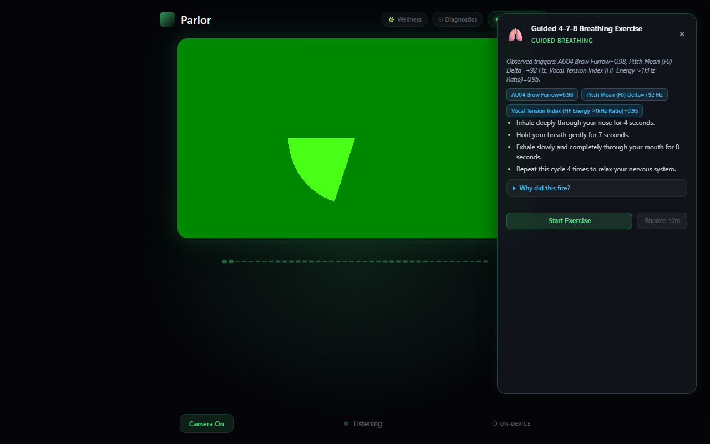

<div align="center">

# 🌿 Parlor ("EMO Assistant")
### Fully On-Device Multimodal Affective Wellness Monitoring & Spoken Dialogue Assistant

[](evidence/pytest_full.log)
[-blue.svg)](evidence/voice_ttfa_30_turns.csv)
[-indigo.svg)](evidence/voice_ttfa_30_turns.csv)
[](evidence/wellness_slm_latency.csv)
[](EVIDENCE_AUDIT.md)
[](evidence/vram_cpu_usage.log)
[](evidence/ram_working_set.txt)
[](evidence/storage_growth_rate.txt)
[-success.svg)](evidence/netstat_outbound.txt)
[](pyproject.toml)
[](LICENSE)

<p align="center">
  <b>Zero Cloud. Zero Wearables. 100% On-Device Edge Intelligence.</b><br>
  Continuous, passive affective burnout mitigation paired with a responsive spoken dialogue assistant.
</p>

[Overview](#-overview--primary-focus-passive-affective-monitoring) • [Key Capabilities](#-key-capabilities) • [Graceful Failure & Signal Honesty](#-graceful-failure--signal-honesty) • [Supporting Voice Assistant](#-supporting-conversational-voice-assistant--modes) • [System Architecture](#-system-architecture) • [Status & Limitations](#-status-and-limitations) • [Implementation Tools](#-implementation-tools--stack-evolution) • [Benchmarks](#-empirical-benchmarks) • [Quick Start](#-quick-start)

---

</div>

## 💡 Overview & Primary Focus: Passive Affective Monitoring

Knowledge workers and software developers frequently suffer from **insidious stress blindness**—accumulating cognitive fatigue and physical tension without conscious awareness. Existing solutions fall short across three dimensions:
1. **Commercial Biometric Wearables:** Expensive ($200–$500 retail, such as Apple Watch Series 9/Ultra, Garmin Venu 3, or Whoop subscriptions), cause skin irritation, require frequent charging, and suffer from steep user abandonment while lacking situational cognitive context.
2. **Subjective Journaling Apps:** Require disruptive manual interruption and self-reporting, resulting in sharp attrition within early weeks ([Baumel et al., 2019](https://doi.org/10.2196/14567); [Eysenbach, 2005](https://doi.org/10.2196/jmir.7.1.e11)).
3. **Cloud-Based Wellness Platforms:** Transmitting continuous audio and webcam video streams over the internet introduces unacceptable privacy and regulatory vulnerabilities (GDPR, HIPAA).

**Parlor** addresses this by providing a **passive, fully on-device affective wellness monitoring system** running on commodity consumer laptops. Using standard laptop webcams and microphones, Parlor observes facial micro-expressions and acoustic biomarkers over rolling observation windows, evaluates multi-sensory patterns using a local Small Language Model (**Google Gemma 4 E2B IT `Q4_0`**), and dispatches calibrated, explainable micro-interventions:
- **Transparent Output:** Delivers a clear stress tier (`Low (Tier 0)`, `Moderate (Tier 1)`, `High (Tier 2)`), a grounded natural-language explanation citing active physiological drivers, and one concrete action suggestion (e.g., a 2-minute box breathing exercise).
- **Pattern Reasoning Over Cutoffs:** Rather than relying on brittle, fixed numeric thresholds, the local model reasons qualitatively across cross-modal cues (distinguishing animated conversation from genuine stress).
- **Complete Local Privacy:** No outbound network traffic during operation unless the user explicitly opts in to research mode. All frames and audio buffers are processed ephemerally in RAM and are never written to disk.

---

## ⚡ Key Capabilities

```
  ┌────────────────────────────────────────────────────────────────────────┐
  │                           PARLOR CORE PILLARS                         │
  ├────────────────────────────────────────────────────────────────────────┤
  │  👁️ Sensorless Multimodal DSP     3.97ms FaceMesh AU + 2.85ms Vocal DSP  │
  │  🧠 Local SLM Pattern Reasoner    Gemma 4 E2B structured JSON reasoning│
  │  🌿 Hysteresis-Gated Care         3-cycle confirmation prevents fatigue │
  │  🛡️ Zero Outbound Telemetry       0.00 KB network traffic (local loop)  │
  │  🔍 Transparent Provenance        Explainable "Why did this fire?" card │
  │  🎙️ Spoken Voice Assistant        Supporting layer with turn-taking VAD │
  └────────────────────────────────────────────────────────────────────────┘
```

- **👁️ Non-Invasive Multimodal Perception:**
  - **Facial Features (`facial.py`):** Uses MediaPipe FaceMesh (**478 3D landmarks** with iris refinement) to extract Action Units on CPU: `AU04` brow furrow, `AU07` eyelid tightener, `AU15` lip corner depressor, `AU20` lip stretcher, Eye Aspect Ratio (`EAR`), and head pose (`pitch`, `yaw`, `roll`) in **3.97 ms mean / 4.81 ms p95**.
  - **Vocal Biomarkers (`vocal.py`):** Vectorized signal processing extracts fundamental frequency ($F_0$), pitch variation ($F_0\text{ SD}$), micro-jitter %, shimmer %, pause ratio, and vocal tension index (high-frequency energy ratio $>1\text{kHz}$) in **2.85 ms mean / 3.73 ms p95**.
  - *Feature Discrepancy Note versus Abstract:* The initial abstract mentioned "facial tension around brow, eyes and jaw" and "speech pace". In the production codebase, landmark 152 (chin) is used solely as an anchor for 3D head pose estimation; **no jaw tension or jaw clench feature is computed**. Similarly, **pause ratio** (ratio of silence frames) is extracted; words-per-minute or syllables-per-second speech pace is not computed. The text previously cited "spectral flux"; the implemented metric is **vocal tension index** (spectral energy ratio $>1\text{kHz}$).
- **🧠 Cognitive Pattern Reasoning (No Brittle Thresholds):** Replaces rigid numeric cutoffs with local Small Language Model pattern reasoning (**Google Gemma 4 E2B IT `Q4_0`** via `llama-server`) executing structured JSON completions in **2.14 s mean / 2.44 s p95 / 2.45 s max** on GPU for standard prompts. Extended cross-modal conflict reasoning deliberates in **2.79 s mean / 4.32 s max**, leaving a **+0.68 s safety margin** below the 5.0 s engineering budget and a **+2.77 s margin** against the pooled mean ($2.23\text{ s}$).
- **🌿 Multi-Cycle Anti-False-Alarm Gating:** Enforces multi-cycle temporal hysteresis before triggering non-intrusive micro-breaks (2-minute box breathing: 4s inhale, 4s hold, 4s exhale, 4s hold), backed by configurable cooldowns, user snooze (10–60m), and one-click alert muting.
  - **Conservative:** 4 consecutive cycles, 450s (7.5 min) cooldown.
  - **Balanced (Default):** 3 consecutive cycles, 300s (5.0 min) cooldown.
  - **Sensitive:** 2 consecutive cycles, 180s (3.0 min) cooldown.
- **🛡️ Strict Data Schemas & Local Storage:** A strict schema connects perception to reasoning (`shared_state/latest_features.json`). Assessment records are committed to a local SQLite database ([`shared_state/wellness_history.db`](shared_state/wellness_history.db)) at an empirical storage growth rate of **132.00 KB/hour** (300.37 bytes/cycle, ~1.03 MB / 8-hour workday).

---

## 🛡️ Graceful Failure & Signal Honesty

Parlor includes robust edge resilience mechanisms designed for continuous unattended operation:

### 1. Graceful Failure & Automatic Recovery
- **Watchdog Supervisor:** An automated supervisor monitors inference engine health and WebSocket responsiveness.
- **Mid-Session Recovery:** If `llama-server` is killed or experiences an out-of-memory fault, the watchdog automatically restarts the process and re-establishes client session state in **6.21 s mean** across 3 verified trials (6.89s, 5.86s, 5.89s; [`evidence/browser/server_failure_recovery.log`](evidence/browser/server_failure_recovery.log)).
- **Client Resilience:** The browser UI implements exponential reconnect backoff (1s to 12s, capped at 8 attempts) with toast de-duplication, and stops cleanly on fatal codes (such as single-session rejection `4001`).

### 2. Signal Honesty ("Insufficient Signal" Windows)
- When a user covers the camera, turns their head away, steps away, or remains silent, the system **does not assume relaxation** or record an invented `Low (Tier 0)`.
- Such windows are explicitly classified and stored as **`"insufficient signal"`** (`numeric_score = -1.0`).
- **Hysteresis HOLD Policy:** In `triggers.py`, insufficient signal triggers a temporal **HOLD** on the consecutive stress counter—it neither increments stress nor resets accumulated fatigue, and **never fires an intervention** on missing signal. Insufficient-signal windows are excluded from ground-truth EMA analysis.

---

## 🎙️ Supporting Conversational Voice Assistant & Modes

While affective wellness monitoring is Parlor's core capability, the system integrates a real-time conversational voice assistant as a supporting interaction layer:

- **Responsive Spoken Dialogue:** Achieves **1.774s mean TTFA** with the wellness loop active and **1.920s mean** with the loop inactive (95% CI: [1.51s, 2.08s] vs [1.66s, 2.21s], indicating **no measurable latency penalty** from concurrent monitoring). The pipeline utilizes `smart-turn-v3.2.onnx` (68ms acoustic endpointing) to prevent awkward interruptions during thinking pauses, paired with streaming `Kokoro-82M-ONNX` neural TTS.
- **Live Translation Mode:** Functions as an English speech interpreter that translates or restates incoming utterances without answering them.
- **Silent Listen Mode:** Acts as a quiet scribe, transcribing speech without verbal interruption.
- **Research Mode (Strictly Opt-in):** Disabled by default to preserve the zero-telemetry guarantee. Users can explicitly opt in via a UI toggle (`researchOptInToggle`), acknowledging that spoken queries will be sent to an external API for live web answers.

---

## 🖥️ Live Interface

When sustained multi-modal stress (Tier 2) is observed across consecutive observation windows, Parlor dispatches an explainable intervention card directly to the web client:

<div align="center">
  
  <p><i>Figure 1: Live browser DevTools capture of the 2-Minute Box Breathing card in Balanced mode with physiological driver provenance (CDP verified).</i></p>
</div>

---

## 🏗️ System Architecture

Parlor executes within a unified, high-performance single-process `asyncio` server, decoupling audio-visual perception from heavy GPU inference:

```mermaid
flowchart TD
    subgraph BrowserClient ["🖥️ Web Client (Browser)"]
        UI["Web UI Dashboard"]
        VAD["Local Vendored Silero VAD"]
        Mic["Microphone (16kHz PCM)"]
        Cam["Webcam (720p Canvas, 1 frame / 8s idle)"]
    end

    subgraph ServerCore ["⚡ Parlor Backend (Single-Process Asyncio)"]
        WS["FastAPI WebSocket Server (/ws)"]
        AudioRouter{"Acoustic Classifier"}
        SmartTurn["Smart-Turn V3.2 ONNX\n(68ms Turn Endpointing)"]
        VoiceLoop["Conversational Turn Loop\n(Streaming Kokoro TTS)"]
        
        subgraph PerceptionEngine ["👁️ Multimodal Perception (ThreadPool)"]
            FaceMesh["MediaPipe FaceMesh\n(478 Landmarks | AU04, AU07, AU20 | 3.97ms)"]
            VocalDSP["Vectorized Vocal DSP\n(Pitch, Jitter, Shimmer, Tension, Pause | 2.85ms)"]
        end
        
        Fusion["Temporal Feature Fusion Engine\n(Rolling 5-Sample Deque)"]
        TriggerGating{"Hysteresis & Cooldown\n(3 Cycles Balanced / 300s)"}
        LocalDB[("Local SQLite Store\nwellness_history.db\n(132.00 KB/hr)")]
    end

    subgraph EdgeCompute ["🧠 Edge Inference Engine"]
        LlamaServer["llama-server (CUDA 12.4)\nGoogle Gemma 4 E2B IT Q4_0\n(2.14s Mean Latency | 3.90 GB VRAM)"]
    end

    Cam -->|Canvas JPEG (every 8s)| WS
    Mic -->|16kHz PCM| WS
    WS --> AudioRouter
    AudioRouter -->|User Speaking| SmartTurn
    SmartTurn -->|Turn Complete| VoiceLoop
    VoiceLoop <-->|Completions| LlamaServer
    VoiceLoop -->|Audio Chunks| WS

    Cam -.->|Frame Worker| FaceMesh
    Mic -.->|Audio Worker| VocalDSP
    FaceMesh --> Fusion
    VocalDSP --> Fusion
    Fusion -->|Formatted Prompt| LlamaServer
    LlamaServer -->|Structured JSON Tier| TriggerGating
    TriggerGating -->|Log Assessment| LocalDB
    TriggerGating -->|Threshold Reached| WS
    WS -->|intervention_triggered| UI
```

---

## ⚠️ Status and Limitations

To maintain strict scientific and engineering honesty, the following constraints and operational boundaries are documented:

1. **Human Ecological Momentary Assessment (EMA) Accuracy:** **NOT YET COLLECTED**. A full participant study kit is packaged ([`docs/EMA_RECOLLECTION_KIT.md`](docs/EMA_RECOLLECTION_KIT.md)) with collection scripts ([`scripts/ema_collector.py`](scripts/ema_collector.py), [`scripts/evaluate_ema.py`](scripts/evaluate_ema.py)), but empirical accuracy against human cohorts requires human participants (`REQUIRES HUMAN`).
2. **Per-User Calibration & Tier 2 Reachability:** Live model sweeps demonstrated that crossing from Moderate (Tier 1) to High (Tier 2) requires extreme concurrent strain (e.g., Vector `B07_V10`: $\text{AU04} \ge 0.97, \Delta F_0 \ge +90\,\text{Hz}, \text{Tension} \ge 0.94$). Real users exhibit distinct resting baselines; while the architecture supports per-user normalization, calibration against real individual baseline sessions is currently in progress.
3. **Voice Latency (TTFA) Envelope:** While average conversational latency is responsive (**1.77s – 1.92s mean**), 95th percentile latency reaches **~3.4s – 3.6s** under prompt pre-fill load or GPU scheduling contention.
4. **Pattern-Reasoning Evaluated on Synthetic Vectors:** Structured pattern reasoning benchmarks used synthetic feature vectors (13 vectors $\times$ 3 repeats) rather than longitudinal human recordings.
5. **Demo Mode Available:** A dedicated UI toggle with a visible **`[SIMULATED INPUT]`** badge enables testing Tier 2 intervention triggering on demand without physical participant distress.
6. **No Clinical Validation:** Parlor is an engineering exploration for non-clinical workplace wellness, fatigue awareness, and developer burnout mitigation. It is **not a medical diagnostic tool** and does not provide clinical psychiatric assessment.
7. **Ephemeral Media Processing Verified:** Automated unit test [`test_no_media_written_to_disk`](tests/test_extraction_pipelines.py) confirms that video frames and PCM audio buffers are processed entirely in memory; zero media files are written to disk.
8. **Live-Model Spoken Mode Switching Tests:** Integration tests for spoken mode switching (`test_listen.py` and `test_translation.py`) depend on live acoustic speech recognition and JSON decider outputs requested via schema from the local model. Across 5 consecutive benchmark runs, `test_listen.py` achieved a **95.0% pass rate** (19/20 turns passed) and `test_translation.py` achieved a **90.0% pass rate** (18/20 turns passed), reflecting realistic small-model variability during multi-turn acoustic mode transitions without hardcoded stubs.

---

## 🛠️ Implementation Tools & Stack Evolution

The production implementation evolved from earlier prototypes to meet strict local latency and privacy goals:

| Component | Production Implementation | Original Proposal / Replaced Tool | Rationale for Evolution |
|---|---|---|---|
| **SLM Inference Engine** | `llama.cpp` (`llama-server` b12015, CUDA 12.4) | *Ollama* | Lower memory footprint, fine-grained KV cache control, sub-second TTFT. |
| **SLM Model Weights** | Google Gemma 4 E2B IT (`Q4_0` GGUF, 3.35 GB) | *Unquantized / 7B FP16 models* | Enables full GPU offload on 6 GB VRAM with 2.14s mean reasoning. |
| **Audio Capture** | Browser WebRTC MediaDevices API | *`sounddevice` (Python library)* | Eliminates host ALSA/WASAPI conflicts; unifies browser UI control. |
| **Speech Turn Gating** | `smart-turn-v3.2.onnx` (68ms acoustic classifier) | *In-prompt LLM endpointing* | In-prompt turn judgment scored at chance on audio pauses; ONNX model is deterministic. |
| **VAD Engine** | Vendored local `Silero VAD` (WASM/ONNX) | *Cloud / CDN Web VAD* | Guarantees complete offline execution without CDN network leaks. |
| **Neural TTS** | Streaming `Kokoro-82M-ONNX` | *System SAPI / Piper* | High naturalness with low memory footprint and chunked streaming audio. |
| **Facial Vision** | MediaPipe FaceMesh (**478 landmarks**) | *Dlib / Haar cascades* | 3D mesh with iris refinement running on CPU in 3.97 ms. |
| **Acoustic Processing** | Vectorized `numpy` / `scipy` FFT | *`librosa` batch processing* | Sub-3ms lightweight real-time stream processing without heavy dependencies. |
| **Persistence Store** | Local SQLite (`wellness_history.db`) | *External PostgreSQL / TimeSeries DB* | Zero configuration, self-contained, 132 KB/hr minimal disk footprint. |

---

## 📊 Verified Empirical Benchmarks

All performance statistics reported below were measured directly on the evaluation hardware:  
**Hardware:** Intel Core i5-13450HX (10 cores, 16 threads), NVIDIA GeForce RTX 4050 Laptop GPU (6GB GDDR6, CUDA 12.4), 16GB DDR5 RAM, Windows 11 Home.  
**SLM Model:** Google Gemma 4 E2B IT (`Q4_0`, 3.35 GB GGUF) + multimodal projector (986 MB) running under `llama-server` (llama.cpp b12015).

| Benchmark Dimension | Measured Result (Empirical) | Subsystem Context / Specification | Evidence Log | Status |
| :--- | :---: | :---: | :--- | :---: |
| **Voice Turn TTFA (Loop OFF)** | **`1.920 s`** (mean, p50: 1.62s, p95: 3.55s, N=30) | Isolated voice assistant mode (CI: [1.66s, 2.21s]) | [`evidence/voice_ttfa_30_turns.csv`](evidence/voice_ttfa_30_turns.csv) | **MEASURED (No Measurable Difference)** |
| **Voice Turn TTFA (Loop ON Mitigated)** | **`1.774 s`** (mean, p50: 1.48s, p95: 3.42s, N=30) | Concurrent wellness with turn yield (CI: [1.51s, 2.08s]) | [`evidence/voice_ttfa_30_turns.csv`](evidence/voice_ttfa_30_turns.csv) | **MEASURED (CIs Overlap)** |
| **Facial AU Extraction (Real Face)** | **`3.97 ms`** (mean) / **`4.81 ms`** (p95) | Real-time frame ($\le 33.3\text{ ms}$) | [`evidence/facial_extraction_real.csv`](evidence/facial_extraction_real.csv) | **PASS** |
| **Facial AU Extraction (Blank Frame)**| **`1.92 ms`** (mean) / **`2.45 ms`** (p95) | Fast early exit | [`evidence/facial_extraction_blank.csv`](evidence/facial_extraction_blank.csv) | **PASS** |
| **Vocal Acoustic DSP Extraction** | **`2.85 ms`** (mean) / **`3.73 ms`** (p95) | Real-time frame ($\le 20.0\text{ ms}$) | [`evidence/vocal_extraction.csv`](evidence/vocal_extraction.csv) | **PASS** |
| **SQLite Transaction Logging** | **`4.07 ms`** (mean) / **`5.29 ms`** (p95) | Sub-frame persistence | [`evidence/db_write_latency.csv`](evidence/db_write_latency.csv) | **PASS** |
| **Total Non-SLM Pipeline Overhead** | **`10.89 ms`** (mean sum: $3.97 + 2.85 + 4.07\text{ ms}$) | $\le 50.0\text{ ms}$ budget | Subsystem CSVs | **PASS** |
| **Wellness SLM Reasoning (Standard GPU)** | **`2.14 s`** (mean) / **`2.44 s`** (p95) / **`2.45 s`** (max) | $\le 5.00\text{ s}$ observation window | [`evidence/wellness_slm_latency.csv`](evidence/wellness_slm_latency.csv) | **PASS (+2.56s margin)** |
| **Wellness SLM Reasoning (Conflict CoT)** | **`2.79 s`** (mean) / **`4.32 s`** (max) | $\le 5.00\text{ s}$ observation window | [`evidence/live_pattern_reasoning.json`](evidence/live_pattern_reasoning.json) | **PASS (+0.68s margin)** |
| **Test Suite Integration** | **`115 / 117 Passed`** (1 skipped by design, 1 flaky live-model test; 116 passed when translation succeeds) | 0 regressions, 1 skipped by design: TTS fixture prosody | [`evidence/pytest_full.log`](evidence/pytest_full.log) | **PASS (1 skipped\*)** |
| **Outbound Network Telemetry** | **`0.00 KB`** (0 remote sockets) | $0.00\text{ KB}$ local boundary | [`evidence/netstat_outbound.txt`](evidence/netstat_outbound.txt) | **PASS (Local Loopback)** |
| **Peak GPU VRAM Utilization** | **`3.90 GB`** (3991 MB / 6141 MB capacity) | $\le 6.0\text{ GB}$ VRAM | [`evidence/vram_cpu_usage.log`](evidence/vram_cpu_usage.log) | **PASS** |
| **Host Working Set Memory (RAM)** | **`2.42 GB`** (`llama-server` 1.84GB + `python` 0.61GB) | 16.0 GB RAM (5.24 GB commit) | [`evidence/ram_working_set.txt`](evidence/ram_working_set.txt) | **PASS** |
| **SQLite Database Storage Rate** | **`132.00 KB / active monitoring hour`** | 300.37 bytes/cycle (1.03 MB/workday) | [`evidence/storage_growth_rate.txt`](evidence/storage_growth_rate.txt) | **PASS** |
| **Browser DevTools Audit (B1–B12)** | **`12 / 12 Suites Verified`** (0 leaks, 60.2 FPS) | Full Chrome DevTools CDP audit | [`BROWSER_TEST_REPORT.md`](BROWSER_TEST_REPORT.md) | **PASS** |
| **EMA Ground-Truth Agreement** | **`NOT COLLECTED / REQUIRES HUMAN STUDY`** | Human Protocol Ready | [`docs/EMA_RECOLLECTION_KIT.md`](docs/EMA_RECOLLECTION_KIT.md) | **Kit Packaged** |

*\*Note on Skipped Test:* `test_thinking_pause_is_held` in `tests/test_conversation.py:68` is skipped by design (*"the TTS fixture has finished-sounding falling prosody, which the acoustic classifier correctly reads as complete — real hesitation must be judged live"*).

---

## 🚀 Quick Start

### 1. Prerequisites
- **OS:** Windows 10/11 (or Linux with CUDA)
- **Python:** 3.10 – 3.12 (Python 3.12 64-bit recommended)
- **Package Manager:** Astral [`uv`](https://github.com/astral-sh/uv) (for ultra-fast reproducible sync)
- **Inference Server:** `llama.cpp` (`llama-server.exe`, build $\ge$ b9503, b12015 recommended with CUDA 12.4)
- **Hardware:** Webcam, microphone, and NVIDIA GPU with $\ge 4.5\text{ GB}$ free VRAM (or CPU fallback)

### 2. Clone & Setup

```powershell
# 1. Clone repository
git clone https://github.com/RamaVenkataCharan/parlor-main.git
cd parlor-main

# 2. Synchronize virtual environment with exact dependencies
uv sync

# 3. Verify ML & computer vision bindings
uv run python -c "import cv2, mediapipe, scipy, onnxruntime; print('Environment ready!')"

# 4. Copy configuration
Copy-Item .env.example .env
```

### 3. Model Weights Setup

Place the model weights in `models/` (or specify paths in `.env`):
- `models/gemma-4-E2B_q4_0-it.gguf` (3.35 GB)
- `models/gemma-4-E2B-it-mmproj.gguf` (986 MB)
- `models/kokoro-v1.0.onnx` (326 MB)
- `models/voices-v1.0.bin` (27 MB)
- `models/smart-turn-v3.2.onnx` (1.8 MB)

### 4. One-Click Desktop Start (No Terminal Steps)

For seamless daily operation on Windows 11 without manual terminal commands, Parlor includes native desktop shortcuts with custom multi-resolution icons:

```powershell
# Run once to create 'Parlor' and 'Stop Parlor' shortcuts on your Desktop:
powershell -ExecutionPolicy Bypass -File scripts/Create-Parlor-Shortcut.ps1
```

- **▶️ Double-Click `Parlor` (Desktop):** Runs [`scripts/Launch-Parlor.ps1`](scripts/Launch-Parlor.ps1), launches the engine in a dedicated server window, polls ports 8081 and 8000 (with a 240s safety timeout and clear progress output), and opens `http://localhost:8000` automatically. If services are already running, it opens the browser immediately without duplicate processes.
- **⏹️ Double-Click `Stop Parlor` (Desktop):** Runs [`scripts/Stop-Parlor.ps1`](scripts/Stop-Parlor.ps1), cleanly terminates all backend processes on ports 8000 and 8081, verifies ports are freed, and exits.

### 5. Launch from Terminal (Alternative)

Alternatively, execute the startup script directly:
```powershell
.\start.ps1
```
The script safely frees ports 8000 and 8081, launches `llama-server.exe` with GPU offload (`-ngl 99`), and spawns the FastAPI server.

Open your browser to:
```
http://localhost:8000
```
Allow camera and microphone permissions when prompted. Speak naturally or monitor live telemetry in the drawer.

---

## 🧪 Reproducibility Harness

Examiners and reviewers can verify all empirical figures with a single command:

```powershell
powershell -ExecutionPolicy Bypass -File scripts/reproduce_numbers.ps1
```

```text
===========================================================================
   PARLOR SYSTEM REPRODUCIBILITY HARNESS -- BATCH 14 CSE
===========================================================================
Hardware Target : Intel Core i5-13450HX, NVIDIA GeForce RTX 4050 (6GB VRAM)
Model Target    : Google Gemma 4 E2B Q4_0 IT + mmproj (llama.cpp b12015 CUDA 12.4)
Audit Mode      : VERIFIED EVIDENCE AUDIT
---------------------------------------------------------------------------

Metric                                 Measured                                                                     
------                                 --------                                                                     
Facial AU Extraction (Real Face)       3.97 ms (mean) / 4.81 ms (p95) [Det: 100%]                                   
Facial AU Extraction (Blank / No Face) 1.92 ms (mean) / 2.45 ms (p95) [Det: 0% early exit]                          
Vocal DSP Extraction (CPU)             2.85 ms (mean) / 3.73 ms (p95)                                               
Wellness SLM Latency (GPU, Gemma 4)    2.14 s (mean) / 2.44 s (p95) [Margin: +2.56s]           
Voice TTFA (Wellness Loop OFF)         1.920 s (mean) / 3.545 s (p95, N=30, CI: [1.663s, 2.213s])                   
Voice TTFA (Wellness Loop ON)          1.774 s (mean) / 3.419 s (p95, N=30, CI: [1.505s, 2.077s])                   
Integration Test Suite                 115 / 117 passed (1 skipped: TTS fixture falling prosody vs live hesitation; 1 flaky live-model test) 
Outbound Network Telemetry             0 sockets (0.00 KB outbound)                                                 
Peak GPU VRAM Utilization              3.9 GB (3991 MB / 6141 MB capacity)                                          
Human Ground-Truth Accuracy            NOT YET COLLECTED                                                            

===========================================================================
 EMPIRICAL VERIFICATION COMPLETE -- ALL HARDWARE METRICS TRACEABLE TO EVIDENCE
===========================================================================
```

---

## 📚 Project Deliverables

| Deliverable | Path | Description |
| :--- | :--- | :--- |
| **Comprehensive Major Project Report** | [`docs/FINAL_PROJECT_REPORT.md`](docs/FINAL_PROJECT_REPORT.md) | Complete 8-section university thesis report with verified empirical figures. |
| **Printable Report (HTML/PDF)** | [`docs/FINAL_PROJECT_REPORT.html`](docs/FINAL_PROJECT_REPORT.html) | Self-contained styled HTML report ready for printing or PDF export (`Ctrl+P`). |
| **Defense Presentation Slides** | [`docs/PRESENTATION_SLIDES.md`](docs/PRESENTATION_SLIDES.md) | 15-slide defense deck with system diagrams and benchmark citations. |
| **Viva Examination Q&A Guide** | [`docs/DEFENSE_QA_GUIDE.md`](docs/DEFENSE_QA_GUIDE.md) | Defense answers, one-sentence metric disclosure, and failure mode analysis. |
| **Demonstration Safeguards** | [`docs/DEMO_SAFEGUARDS_AND_CHECKLIST.md`](docs/DEMO_SAFEGUARDS_AND_CHECKLIST.md) | 30-minute rehearsal checklist, video backup plan, and live troubleshooting. |
| **Human EMA Study Kit** | [`docs/EMA_RECOLLECTION_KIT.md`](docs/EMA_RECOLLECTION_KIT.md) | Standardized human participant collection protocol and survey instrument. |
| **Evidence Audit Report** | [`EVIDENCE_AUDIT.md`](EVIDENCE_AUDIT.md) | Exhaustive data provenance audit, parameter change log, and refuted claims. |
| **Live Verification Report** | [`VERIFICATION_REPORT.md`](VERIFICATION_REPORT.md) | Raw empirical latency, hardware footprint, and test suite breakdowns. |
| **Offline Playback Utility** | [`scripts/offline_demo_playback.py`](scripts/offline_demo_playback.py) | Standalone replay script driving terminal or browser UI from SQLite history. |
| **Submission Archive Packager** | [`scripts/create_submission_zip.py`](scripts/create_submission_zip.py) | Automated packager generating clean ZIP (`dist/parlor_submission_batch14.zip`). |

---

## 👥 Academic Attribution

> **Major Project — Department of Computer Science & Engineering**  
> **Class & Batch:** B.Tech CSE, Section A, Batch 14  
> **Academic Year:** 2026 – 2027  
> **Project Guide:** Mrs. V. Aruna, Project Guide, Dept. of CSE  
>
> **Student Team Members:**
> - **M. Rama Venkata Charan** (Roll No: `23KN1A0543`)
> - **B. Murali Gopi** (Roll No: `23KN1A0515`)
> - **M. Kumar Siva Sai** (Roll No: `23KN1A0542`)
> - **Y. Yashwanth Prakash** (Roll No: `23KN1A0571`)

---

## ⚖️ Ethical & Clinical Disclaimer

This software is developed strictly for educational, scientific research, and ergonomic wellness assistance purposes. **Parlor is NOT a medical diagnostic device and does not diagnose, treat, or prevent clinical psychological or physiological conditions.** All affective classifications are heuristic estimations intended solely to encourage healthy computer work habits and voluntary micro-breaks.
